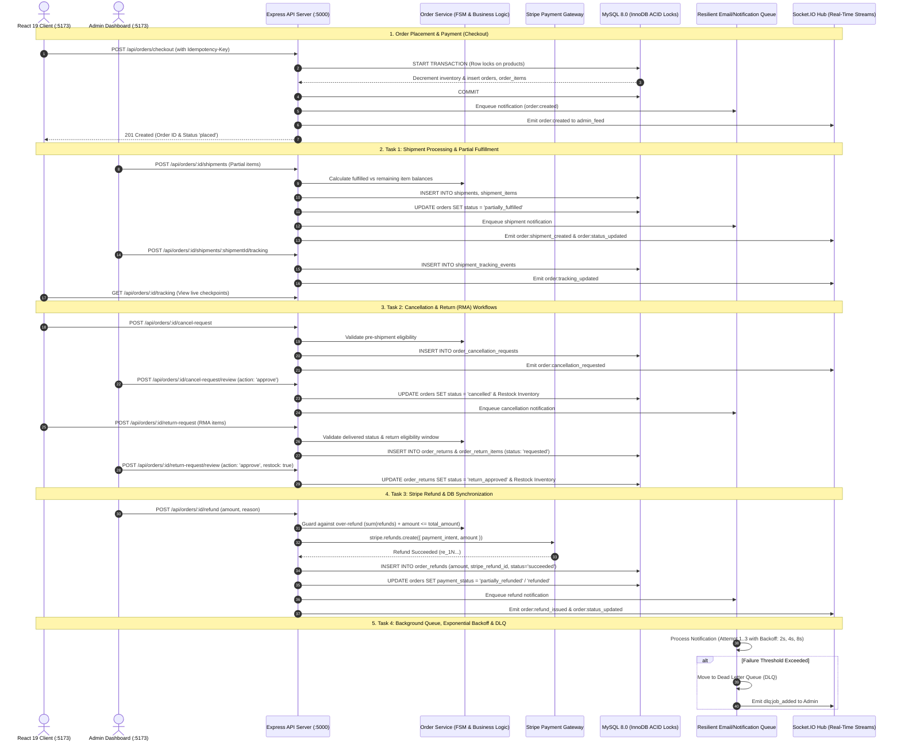
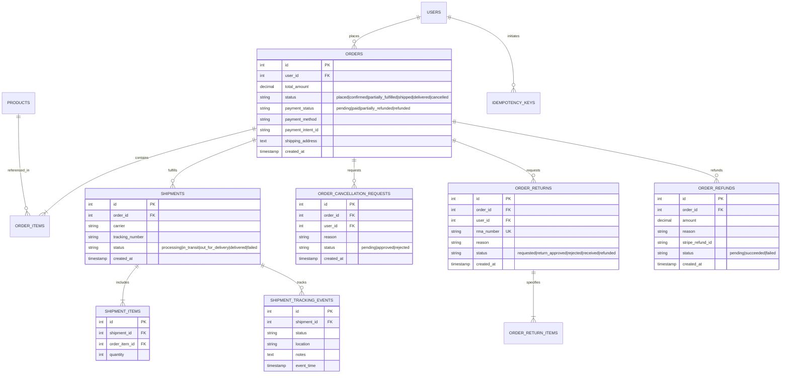

# Code Map & Enterprise System Architecture Blueprint

This document provides the architectural code map, schema contracts, database table designs, data flows, and endpoint routing tables for the full-stack MERN & MySQL enterprise order lifecycle platform.

---

## 🏗️ 1. End-to-End Order Lifecycle Flow Map



---

## 📁 2. File & Directory Layout

```text
MERN_Stack_Roadmap/
├── README.md                                           # Master repository guide & quickstart
├── SKILL.md                                            # Practical CLI commands, test scripts & cURL
├── CODE-MAP.md                                         # Architectural blueprint, schema contracts & routes
├── OPEN-QUESTIONS.md                                   # System design trade-offs & interview dilemmas
├── notes.md                                            # In-depth technical notes & design patterns
├── mongodb-and-rest.md                                 # MySQL vs MongoDB comparison & REST principles
├── ORDER_LIFECYCLE_MASTER_DOCUMENTATION.md             # Standard 9-section master lifecycle documentation
├── docs/
│   ├── END_TO_END_ORDER_LIFECYCLE_REPORT.md            # Generated end-to-end order lifecycle report
│   ├── INTEGRATION_REPORT.md                           # Enterprise integration report & audit logs
│   ├── INTEGRATION_DEBUGGING_PLAYBOOK.md               # SRE runbook & debugging guide
│   └── SHOPSPHERE_SYSTEM_ARCHITECTURE.md               # Topology & architectural diagrams
├── backend/
│   ├── server.js                                       # Express HTTP server & Socket.IO server initialization
│   ├── config/
│   │   └── db.js                                       # MySQL connection pool (InnoDB)
│   ├── controllers/
│   │   ├── orderController.js                          # Core order, shipment, return, refund HTTP handlers
│   │   ├── authController.js                           # User registration, login & JWT auth
│   │   └── productController.js                        # Product catalog & stock management
│   ├── services/
│   │   ├── orderService.js                             # Finite State Machine (FSM), shipments, returns & refunds
│   │   ├── stripeService.js                            # Stripe PaymentIntents, refunds & webhook processor
│   │   ├── emailQueue.js                               # Resilient notification queue with DLQ & exponential backoff
│   │   ├── socketService.js                            # Socket.IO room dispatcher & real-time streams
│   │   ├── razorpayService.js                          # Razorpay order generation & HMAC verification
│   │   └── telemetryService.js                         # Distributed tracing & APM metrics
│   ├── routes/
│   │   ├── orderRoutes.js                              # /api/orders routing table (26 endpoints)
│   │   ├── productRoutes.js                            # /api/products routing table
│   │   └── authRoutes.js                               # /api/auth routing table
│   └── scripts/
│       ├── testTask5IntegrationSuite.js                # Task 5: 45-assertion end-to-end integration test runner
│       ├── generateOrderLifecycleReport.js             # Task 6: Order lifecycle report generator
│       ├── clearAllOrdersAndData.js                    # Database maintenance & catalog reset script
│       ├── testOrderCancellationFlow.js                # Cancellation & restocking verification
│       ├── testOrderRealtimeAndQueue.js                # Real-time WebSocket & email queue verification
│       └── testRazorpayIntegration.js                  # Razorpay signature verification test
└── frontend/
    └── src/
        ├── components/
        │   ├── CartDrawer.jsx                          # Dual-tier checkout drawer
        │   ├── OrdersTrackerModal.jsx                  # Customer live tracking modal & order history
        │   ├── OrderStatusStepper.jsx                  # Interactive fulfillment stepper, checkpoints & RMA modal
        │   └── dashboard/
        │       ├── RealTimeOrdersManager.jsx           # Admin orders feed, partial shipment drawer & refund tool
        │       └── StripeIdempotencyStudio.jsx         # Idempotency & webhook simulation lab
        ├── context/
        │   ├── AuthContext.jsx                         # User session & role management
        │   ├── CartContext.jsx                         # Shopping cart & pricing state
        │   └── SocketContext.jsx                       # Real-time Socket.IO connection manager
        └── pages/
            ├── Products.jsx                            # Products catalog & price filtering
            └── Dashboard.jsx                           # Admin operations, telemetry & diagnostics
```

---

## 🛣️ 3. API Routing Table

| Method | Endpoint | Description | Task Scope |
| :--- | :--- | :--- | :--- |
| `POST` | `/api/orders/checkout` | Create order with ACID row lock & idempotency check | Checkout Core |
| `POST` | `/api/orders/:id/shipments` | Create full or partial shipment with line-item allocation | **Task 1** |
| `GET` | `/api/orders/:id/shipments` | List all shipments and tracking numbers for an order | **Task 1** |
| `POST` | `/api/orders/:id/shipments/:shipmentId/tracking` | Append tracking checkpoint event (location, status, notes) | **Task 1** |
| `GET` | `/api/orders/:id/tracking` | Customer live tracking checkpoints and shipment status | **Task 1** |
| `PATCH`| `/api/orders/:id/status` | Transition order status with FSM validation | **Task 1** |
| `GET` | `/api/orders/:id/eligibility` | Check cancellation and return eligibility rules | **Task 2** |
| `POST` | `/api/orders/:id/cancel-request` | Customer requests pre-shipment order cancellation | **Task 2** |
| `POST` | `/api/orders/:id/cancel-request/review` | Admin review (approve/reject) cancellation with optional refund | **Task 2** |
| `POST` | `/api/orders/:id/return-request` | Customer requests RMA return with line items & reason | **Task 2** |
| `POST` | `/api/orders/:id/return-request/review` | Admin review (approve/reject) RMA return with optional restock | **Task 2** |
| `GET` | `/api/orders/requests/returns` | List pending return requests for admin review | **Task 2** |
| `GET` | `/api/orders/requests/cancellations` | List pending cancellation requests for admin review | **Task 2** |
| `POST` | `/api/orders/:id/refund` | Issue Stripe refund, guard against over-refund, update DB | **Task 3** |
| `GET` | `/api/orders/:id/refunds` | Retrieve complete refund audit ledger for order | **Task 3** |
| `POST` | `/api/orders/webhook` | Stripe webhook listener with cryptographic signature verification | **Task 3** |
| `POST` | `/api/orders/simulate-webhook` | Synthetic Stripe webhook test simulation endpoint | **Task 3** |
| `GET` | `/api/orders/email-queue/stats` | Background notification queue statistics (active, dlq, etc.) | **Task 4** |
| `GET` | `/api/orders/email-queue/logs` | Background worker execution logs | **Task 4** |
| `GET` | `/api/orders/email-queue/dlq` | List Dead Letter Queue (DLQ) failed jobs | **Task 4** |
| `POST` | `/api/orders/email-queue/jobs/:id/retry` | Re-queue specific DLQ job | **Task 4** |
| `POST` | `/api/orders/email-queue/dlq/retry-all` | Re-queue all DLQ jobs | **Task 4** |
| `POST` | `/api/orders/email-queue/fault-injection` | Toggle simulated delivery failure for resilience testing | **Task 4** |
| `POST` | `/api/orders/integration-tests/run` | Execute 45-assertion automated integration test suite | **Task 5** |
| `POST` | `/api/orders/clear-all-data` | Clear all test orders, shipments, returns, refunds & reset stock | **Task 6** |
| `GET` | `/api/orders/consistency/check` | Audit database inventory consistency | **Task 6** |

---

## 🗄️ 4. Relational Database Schema & Table Definitions


