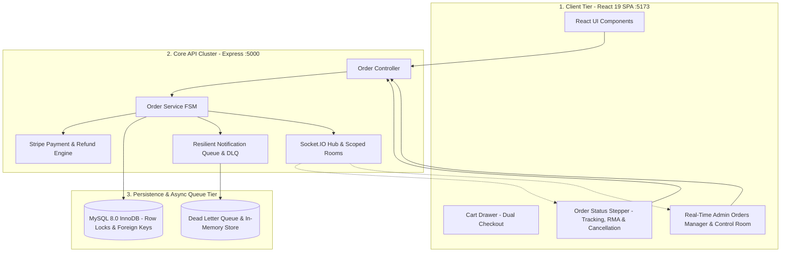

# 🛒 ShopSphere Enterprise Full-Stack Order Lifecycle Platform

Welcome to the **ShopSphere Enterprise E-Commerce & Systems Integration** platform. This repository demonstrates production-grade full-stack architecture patterns spanning **React 19 SPA**, **Express API Cluster**, **MySQL 8.0 (InnoDB ACID Transactions & Row Locks)**, **Stripe Payment Gateway & Webhook Engine**, **Socket.IO Real-Time Streams**, and **Asynchronous Notification Queue Workers with DLQ Retries**.

---

## 🎯 The 6 Core Enterprise Order Lifecycle Tasks

### 📦 Task 1: Shipment Processing, Partial Fulfillment & Tracking
* **Partial Fulfillment Logic**: Support splitting customer orders across multiple discrete shipments when items are fulfilled from separate distribution hubs or suppliers.
* **Line-Item Quantity Allocation**: Real-time tracking of ordered vs. shipped vs. remaining line-item quantities; automatically transitions order status between `partially_fulfilled` and `shipped`/`fulfilled`.
* **Shipment Carrier & Tracking**: Assignment of logistics carrier (FedEx, DHL, UPS) and unique tracking numbers with real-time audit checkpoints.
* **Customer Live Tracking**: Dedicated [OrderStatusStepper.jsx](file:///c:/Users/Admin/Documents/doc/Exe.GitHub/MERN_Stack_Roadmap/frontend/src/components/OrderStatusStepper.jsx) providing live visual timeline updates and tracking events via Socket.IO.

### 🔄 Task 2: Return-Request (RMA) & Cancellation Workflows
* **Pre-Shipment Cancellations**: Strict eligibility validation allowing customers to request cancellation only prior to dispatch (`placed`, `confirmed`, `pending`).
* **Post-Delivery Returns (RMA)**: Return merchandise authorization workflow allowing customers to request item-level returns with reason codes within valid return windows.
* **Admin Review Queue**: Dedicated admin approval/rejection interface with optional automated inventory restocking and automated refund triggers.
* **Finite State Machine (FSM)**: Strict `VALID_TRANSITIONS` rules preventing invalid order-state skipping or modifications to cancelled/refunded orders.

### 💳 Task 3: Stripe Refund Integration & Database Synchronization
* **Stripe Refund Execution**: Integration with Stripe's Refund API (`stripe.refunds.create`) supporting both partial compensation and full refunds.
* **Database Ledger Synchronization**: Every refund creates an immutable audit record in `order_refunds` with gateway reference `stripe_refund_id`.
* **Over-Refund Protection**: Strict server-side invariant asserting that $\sum \text{Refunds} \le \text{Order Total Amount}$; rejects illegal excessive refund requests.
* **Order Status Sync**: Order `payment_status` automatically transitions to `partially_refunded` or `refunded` upon confirmation.

### 🔔 Task 4: Background Notification Queue, Exponential Backoff & DLQ
* **Decoupled Job Queue**: Asynchronous background worker (`emailQueue.js`) processing notifications for order placement, shipment dispatch, tracking updates, return approvals, and refund settlements.
* **Fault-Tolerant Retries**: Failed deliveries automatically retry up to 3 times with exponential backoff delays ($2\text{s}, 4\text{s}, 8\text{s}$).
* **Dead Letter Queue (DLQ)**: Permanently failing jobs are isolated into the DLQ with failure diagnostics and admin re-queueing capabilities (`POST /api/orders/email-queue/jobs/:id/retry`).
* **Real-Time WebSockets**: Instant event dispatch to customer and admin rooms via [socketService.js](file:///c:/Users/Admin/Documents/doc/Exe.GitHub/MERN_Stack_Roadmap/backend/services/socketService.js).

### 🧪 Task 5: Automated Integration Test Suite (45/45 Passed)
* Comprehensive Node.js integration test runner ([testTask5IntegrationSuite.js](file:///c:/Users/Admin/Documents/doc/Exe.GitHub/MERN_Stack_Roadmap/backend/scripts/testTask5IntegrationSuite.js)) validating:
  1. Partial shipments, multiple parcel tracking, and order status transitions.
  2. Cancellation eligibility rules, admin approvals, and status guards.
  3. RMA return requests, admin inspection, and stock restocking.
  4. Stripe partial & full refunds, ledger synchronization, and over-refund rejection.
  5. Duplicate webhook events idempotency.
  6. Rejection of invalid finite-state-machine order transitions.

### 📊 Task 6: End-to-End Order Lifecycle Report & Database Maintenance
* Automated lifecycle report generator ([generateOrderLifecycleReport.js](file:///c:/Users/Admin/Documents/doc/Exe.GitHub/MERN_Stack_Roadmap/backend/scripts/generateOrderLifecycleReport.js)) producing detailed analytics across Order $\rightarrow$ Payment $\rightarrow$ Fulfillment $\rightarrow$ Return $\rightarrow$ Refund.
* Published report artifact: [docs/END_TO_END_ORDER_LIFECYCLE_REPORT.md](file:///c:/Users/Admin/Documents/doc/Exe.GitHub/MERN_Stack_Roadmap/docs/END_TO_END_ORDER_LIFECYCLE_REPORT.md).
* Complete environment reset tool ([clearAllOrdersAndData.js](file:///c:/Users/Admin/Documents/doc/Exe.GitHub/MERN_Stack_Roadmap/backend/scripts/clearAllOrdersAndData.js)) and UI clear button.

---

## 🏛️ System Architecture Topology



---

## 🗄️ MySQL Database Schema

The database model incorporates 10 relational tables supporting the complete order lifecycle:

```text
orders                          -> Core order header (status, payment_status, total_amount, shipping_address)
order_items                    -> Line items per order (product_id, quantity, price)
products                       -> Catalog inventory with row-level locking
shipments                      -> Shipments dispatched per order (carrier, tracking_number, status)
shipment_items                 -> Quantity of each line item included in a shipment
shipment_tracking_events       -> Checkpoints for tracking (location, status, notes, event_time)
order_cancellation_requests    -> Pre-shipment cancellation requests with admin review status
order_returns                  -> RMA return requests with return status and RMA number
order_return_items             -> Line items and quantities requested for return
order_refunds                  -> Financial refund records linked to Stripe refund IDs
idempotency_keys               -> Atomic idempotency store preventing duplicate actions
```

---

## 🛣️ API Routes Quick Reference

| Method | Route | Description |
| :--- | :--- | :--- |
| `POST` | `/api/orders/checkout` | Create order with ACID row lock & idempotency check |
| `POST` | `/api/orders/:id/shipments` | Create partial or full shipment |
| `GET` | `/api/orders/:id/shipments` | Get order shipments |
| `POST` | `/api/orders/:id/shipments/:shipmentId/tracking` | Add shipment tracking checkpoint |
| `GET` | `/api/orders/:id/tracking` | Get live order tracking history |
| `PATCH`| `/api/orders/:id/status` | Update order status with FSM check |
| `GET` | `/api/orders/:id/eligibility` | Check cancellation and return eligibility |
| `POST` | `/api/orders/:id/cancel-request` | Submit customer cancellation request |
| `POST` | `/api/orders/:id/cancel-request/review` | Admin review (approve/reject) cancellation |
| `POST` | `/api/orders/:id/return-request` | Submit customer RMA return request |
| `POST` | `/api/orders/:id/return-request/review` | Admin review (approve/reject) return request |
| `POST` | `/api/orders/:id/refund` | Issue Stripe refund with balance guard |
| `GET` | `/api/orders/:id/refunds` | Get complete refund ledger |
| `GET` | `/api/orders/email-queue/stats` | Inspect background notification queue |
| `GET` | `/api/orders/email-queue/dlq` | Inspect Dead Letter Queue (DLQ) |
| `POST` | `/api/orders/email-queue/jobs/:id/retry` | Re-queue failed job from DLQ |
| `POST` | `/api/orders/integration-tests/run` | Run 45-assertion test suite via API |
| `POST` | `/api/orders/clear-all-data` | Clear test data & reset catalog inventory |

---

## 🚀 Quick Start Guide

### 1. Setup Environment
Ensure MySQL 8.0 is running on `localhost:3306` with database `mern_stack_roadmap`. Verify `backend/.env`:
```env
PORT=5000
DB_HOST=localhost
DB_USER=root
DB_PASSWORD=your_mysql_password
DB_NAME=mern_stack_roadmap
JWT_SECRET=enterprise_jwt_super_secret_key_2026
STRIPE_SECRET_KEY=sk_test_mock_or_real_key
```

### 2. Start Backend Server
```bash
cd backend
npm install
node server.js
```

### 3. Start Frontend App
```bash
cd frontend
npm install
npm run dev
```

### 4. Run Task 5 Integration Test Suite
```bash
cd backend
node scripts/testTask5IntegrationSuite.js
```

### 5. Generate Task 6 Order Lifecycle Report
```bash
cd backend
node scripts/generateOrderLifecycleReport.js
```

### 6. Clean Database & Reset Inventory
```bash
cd backend
node scripts/clearAllOrdersAndData.js
```
