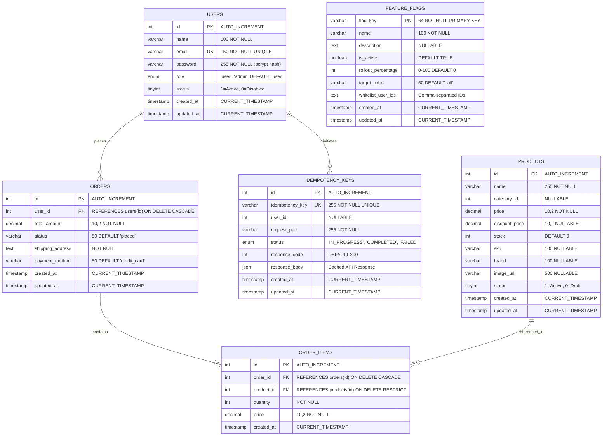
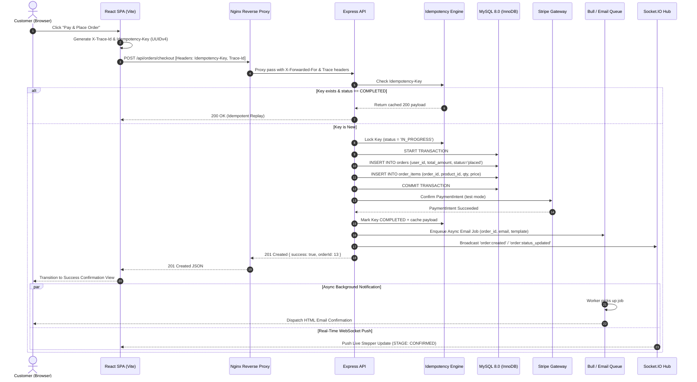

# 🏛️ ShopSphere Enterprise System Architecture & Integration Blueprint

> **System Version**: 2.0.0 (Production Blueprint)  
> **Topology**: React SPA (Vite/Tailwind) ⇄ Nginx (Edge Proxy / Same-Origin) ⇄ Express.js API ⇄ MySQL 8.0 (InnoDB) ⇄ Redis / Bull Queue ⇄ Stripe Payment Gateway

---

## 1. System Topology Overview

```
                        ┌──────────────────────────────────────────────┐
                        │              Client Tier                     │
                        │   React 19 SPA (Vite + TailwindCSS)          │
                        └──────────────────────┬───────────────────────┘
                                               │ HTTP / HTTPS (Port 80/443)
                                               ▼
                        ┌──────────────────────────────────────────────┐
                        │         Edge Ingress & Reverse Proxy         │
                        │           Nginx 1.25 Alpine Linux            │
                        │  - SSL Termination & Security Headers        │
                        │  - Same-Origin `/api` & `/uploads` Proxying  │
                        │  - Static Asset Caching (1 Year Immutable)   │
                        └───────┬──────────────────────────────┬───────┘
                                │                              │
                   Static / Uploads Requests               API Requests
                                │                              │
                                ▼                              ▼
    ┌──────────────────────────────────────┐     ┌──────────────────────────────────────┐
    │     CDN / Static File System         │     │     Application Service Cluster      │
    │  - `/uploads/products/*`             │     │     Express 4.x / Node.js Engine     │
    │  - `dist/assets/*.js`, `*.css`       │     │  - APM Distributed Tracing          │
    └──────────────────────────────────────┘     │  - Feature Flag Progressive Engine   │
                                                 │  - Stripe Idempotency Middleware     │
                                                 └───────┬──────────────────────┬───────┘
                                                         │                      │
                                 Transactional Queries   │                      │ Job Enqueue
                                                         ▼                      ▼
    ┌────────────────────────────────────────────────────────┐     ┌────────────────────────────────────┐
    │              Relational Database Tier                  │     │        Cache & Queue Tier          │
    │               MySQL 8.0 InnoDB Engine                  │     │      Redis 7.0 / In-Memory Bull    │
    │  - ACID Row-Level Locking (`FOR UPDATE`)               │     │  - Asynchronous Email Notifications│
    │  - Foreign Key Constraints & Cascades                  │     │  - Sub/Pub WebSocket Event Broker  │
    └────────────────────────────────────────────────────────┘     └────────────────────────────────────┘
```

---

## 2. MySQL Entity-Relationship (ER) Diagram



---

## 3. End-to-End Sequence Diagrams

### Sequence 1: ACID Checkout with Stripe, Idempotency & Async Email Queue



---

### Sequence 2: Feature Flag Progressive Rollout & Deterministic User Bucketing

```mermaid
sequenceDiagram
    autonumber
    actor User as User (Session)
    participant React as React SPA
    participant Engine as Feature Flag Engine
    participant DB as MySQL feature_flags

    User->>React: Open Application / Dashboard
    React->>Engine: GET /api/feature-flags/evaluate?userId=4&role=customer
    Engine->>DB: SELECT * FROM feature_flags WHERE is_active = TRUE
    DB-->>Engine: Returns active flags: [new_checkout_v2 (50%)]
    
    rect rgb(30, 27, 75)
        note over Engine: Deterministic Polynomial Hashing<br/>Hash("4:new_checkout_v2") = 23<br/>Bucket = 23 < 50% => TRUE
    end
    
    Engine-->>React: { new_checkout_v2: true, express_shipping: false }
    React->>React: FeatureFlagContext sets state
    
    alt Flag is TRUE
        React-->>User: Render Variant B (Next-Gen Checkout v2 with Multi-Payment)
    else Flag is FALSE
        React-->>User: Render Variant A (Stable Legacy Checkout v1)
    end
```



---

### Sequence 3: End-to-End Distributed APM Tracing & Telemetry Propagation

```mermaid
sequenceDiagram
    autonumber
    participant Client as React Client Tracing
    participant Middleware as Express Tracing Middleware
    participant SpanRecorder as APM Span Recorder
    participant DB as MySQL Query Driver
    participant Dashboard as SRE Telemetry Dashboard

    Client->>Client: Start Root Trace: `trace_checkout_1791520`
    Client->>Middleware: POST /api/orders/checkout [traceparent: 00-traceid-spanid-01]
    Middleware->>SpanRecorder: Open Request Span
    
    SpanRecorder->>DB: Execute Query: `START TRANSACTION`
    DB-->>SpanRecorder: Query resolved (2.4ms)
    SpanRecorder->>SpanRecorder: Record Span `MySQL: START TRANSACTION`
    
    Middleware->>Middleware: Complete Response (Status: 201, Total: 18.2ms)
    Middleware->>SpanRecorder: Close Trace Waterfall & Compute Server-Timing
    Middleware-->>Client: Response + Headers [Server-Timing: app;dur=18.2, db;dur=2.4]
    
    Dashboard->>SpanRecorder: GET /api/telemetry/traces
    SpanRecorder-->>Dashboard: Waterfall JSON with Category Breakdown
    Dashboard-->>Dashboard: Render Interactive APM Waterfall Graph
```

---

## 4. Key Architectural Patterns & Guarantees

1. **ACID Transactional Guarantees**:
   Every multi-table state transition in MySQL executes on a single leased connection inside `START TRANSACTION ... COMMIT / ROLLBACK` to eliminate partial writes or orphaned records.
2. **Deterministic Replay-Safe Idempotency**:
   Protects against double-billing and duplicate order generation during network retries using database-backed unique idempotency keys with payload caching.
3. **Decoupled Asynchronous Background Workers**:
   Critical user-facing HTTP request-response cycles are never blocked on external SMTP handshakes; emails and heavy tasks are offloaded to an asynchronous background worker queue.
4. **Zero-Downtime Feature Flags & Blast-Radius Mitigation**:
   Progressive delivery is governed by deterministic user bucketing, role targeting, and instant database-backed kill-switches.
5. **Observability & Distributed Tracing**:
   Every request carries a correlated `X-Trace-Id` propagating across React, Nginx, Express, MySQL queries, and background worker queues.
